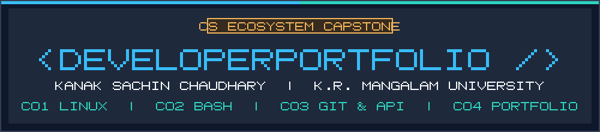
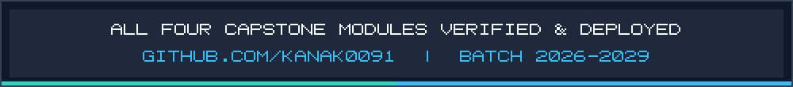

 

---

## Repository Architecture

| Directory / File | Course Outcome | Deliverables & Description |
| :--- | :---: | :--- |
| **`Linux/`** | **CO1** | `system_profile.md` (hardware specs table & manual binary conversions) and `commands_output.txt` (`ls`, `ps`, `df`, `free` logs). |
| **`ShellScripts/`** | **CO2** | `sysinfo.sh` (automated hardware & top-CPU reporter) and `backup.sh` (timestamped `.tar.gz` archive & logging utility). |
| **`API/`** | **CO3** | `github_profile.json`, `sample_posts.json`, and `api_summary.md` (REST concepts, HTTP status codes, and `jq` filter analysis). |
| **`Portfolio/`** | **CO4** | `resume.pdf` (one-page technical resume) and `learning_roadmap.md` (multi-semester CS specialization roadmap). |
| **`Screenshots/`** | **All** | Live terminal and profile verification captures (`backup_demo.png`, `github_profile.png`, `linkedin_profile.png`). |
| **`index.html`** | **CO4** | Responsive static portfolio webpage deployed via GitHub Pages. |

---

## Tech Stack & Tools

---

## Verification Evidence & Live Links

| Artifact | Status | Preview / Direct Link |
| :--- | :---: | :--- |
| **Backup Script Execution (`ShellScripts/backup.sh`)** |  | [`Screenshots/backup_demo.png`](Screenshots/backup_demo.png) |
| **GitHub Developer Profile (`@Kanak0091`)** |  | [`Screenshots/github_profile.png`](Screenshots/github_profile.png) • [Open Profile](https://github.com/Kanak0091) |
| **LinkedIn Professional Profile** |  | [`Screenshots/linkedin_profile.png`](Screenshots/linkedin_profile.png) • [Open Profile](https://www.linkedin.com/in/kanak-chaudhary-bbba52430) |

 

